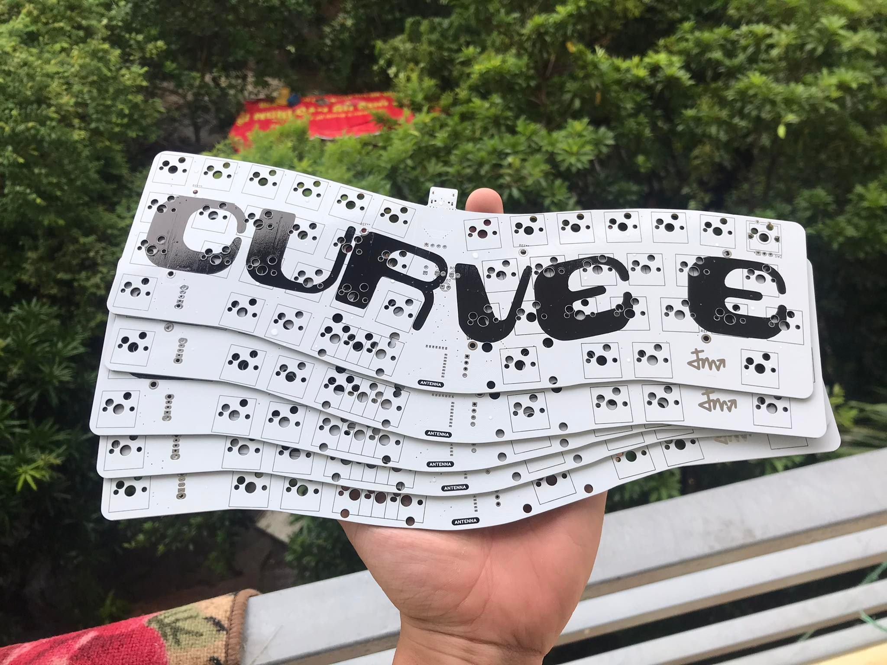

# Curve E Firmware

Firmware và công cụ bảo trì độc lập cho **Curve E PCB Prototype 1**, dựa trên
ZMK. Dự án duy trì board source, cấu hình, quy trình build và bằng chứng kiểm
chứng tại local; ZMK/Zephyr là dependency được khóa revision.

Phần cứng do Deemen17 thiết kế. Dự án kế thừa board/config ban đầu, giữ nguồn
gốc và copyright tại [NOTICE](NOTICE.md); được phát triển và bảo trì riêng.

| Bạn cần gì? | Bắt đầu ở đâu? |
| --- | --- |
| Sử dụng, nạp firmware, đổi phím hoặc khôi phục | [Hướng dẫn thao tác](guides/README.md) |
| Hiểu thiết kế, cấu hình và mức kiểm chứng | [Tài liệu kỹ thuật](docs/README.md) |
| Lấy firmware để sử dụng | [Danh mục firmware chính](firmware/README.md) |
| Tra cứu hoặc phục dựng phần cứng | [Tư liệu phần cứng](hardware/README.md) |
| Phát triển và đóng góp | [Quy trình phát triển](CONTRIBUTING.md) |

## Tính năng và trạng thái

- **Bản chính USB/BLE:** Studio qua USB, layout cong 47 phím, keymap nhiều
  layer và mouse emulation. Đã xác nhận USB/Studio; còn nghiệm thu BLE thực tế,
  nút hybrid và sleep/wake. BLE là wireless mặc định và là yêu cầu ổn định bắt buộc.
- **ESB 2,4 GHz:** prototype USB+ESB riêng cho Curve E và receiver nRF52840 DK.
  Đã build/probe phần mềm; chưa nạp/thử radio, chưa tích hợp ba mode vào bản chính.
  [Nguồn và giới hạn](experimental/esb/README.md).
- **Phần cứng:** đã có ảnh, GPIO/matrix và thông tin USB/bootloader. Chưa có
  schematic/CAD/BOM đầy đủ để chế tạo. [Trạng thái tự chủ](docs/status.md).

Không coi build đạt là nghiệm thu độ ổn định không dây. Phân biệt artifact
chính, thử nghiệm và bằng chứng lịch sử tại [firmware](firmware/README.md).

## Build và cấu trúc nguồn

```sh
./tools/build-firmware.sh       # Bản chính, offline từ cache đã pin
./tools/build-esb.sh all        # Prototype cách ly; không nạp thiết bị
```

Máy mới cần chuẩn bị workspace/image trước theo [hướng dẫn build](guides/build-firmware.md).
Cả hai lệnh lưu log/config/artifact trong repo và không tự ghi đè release.
Không truy cập serial, flash hay thay bootloader.

[product.json](product.json) là danh mục hiện hành: board target, image build,
manifest dependency và release baseline. Source ZMK chuẩn ở [boards/curve_e](boards/curve_e/board.yml),
[config](config/curve_e.conf) và [zephyr/module.yml](zephyr/module.yml).
Giữ target `curve_e//zmk` và định danh USB/BLE hiện có.

Nguồn cũ chỉ dùng tham chiếu được gom tại [archive](archive/README.md).

Xem [thay đổi](CHANGELOG.md), [giấy phép](LICENSE) và [attribution](NOTICE.md).


