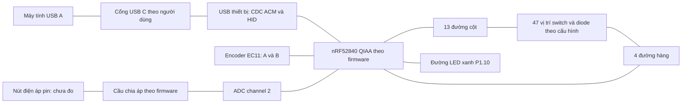

# Curve E Prototype 1 — tài liệu kết nối phần cứng

[Mục lục tài liệu](README.md) · [Nguồn tham khảo](references/README.md)

Tái tạo từ firmware trong repo và nhận diện thiết bị USB ngày 28/10/2026.
Đây là bước đầu của việc khôi phục sơ đồ nguyên lý đầy đủ; chưa phải bản mạch
đã xác minh để chế tạo. Tên Prototype 1 và tác giả Deemen17 lấy từ README gốc;
ảnh PCB người dùng cung cấp cũng ghi Prototype 1; chưa xác minh đó chính là
bo đang cắm USB.

## Nguồn và mức xác nhận

| Nguồn | Nội dung có thể xác nhận |
| --- | --- |
| [curve_e_nrf52840_zmk.dts](../boards/curve_e/curve_e_nrf52840_zmk.dts) | GPIO, ma trận, encoder, LED, cấu hình đo pin và USB |
| [curve_e.keymap](../boards/curve_e/curve_e.keymap) | Thứ tự 47 vị trí và chức năng phím theo layer |
| [curve_e_nrf52840_zmk_defconfig](../boards/curve_e/curve_e_nrf52840_zmk_defconfig), [Kconfig](../boards/curve_e/Kconfig), [Kconfig.defconfig](../boards/curve_e/Kconfig.defconfig) | nRF52840 QIAA, DCDC được yêu cầu, clock 32 kHz dùng RC, USB/BLE |
| [curve_e.conf](../config/curve_e.conf) | Encoder, báo pin, sleep và cấu hình Bluetooth |
| [Bản ghi USB](../hardware/evidence/usb-2026-10-28.json) | Descriptor thiết bị đang cắm; có thời điểm và commit nguồn |
| [Ảnh 1: mặt chữ CURVE E](../hardware/evidence/pcb-front-user.png), [ảnh 2: mặt linh kiện](../hardware/evidence/pcb-back-user.png) | Người dùng cung cấp ngày 28/10/2026; quan sát hình học, silkscreen và linh kiện nhìn thấy |

**Firmware khai báo** không đồng nghĩa **đã đo trên PCB**. Chưa đọc firmware/flash
thiết bị, chưa xác nhận firmware đang chạy trùng repo. GPIO bên dưới là tên cổng
logic, không phải số pad/ball vật lý của chip hoặc số chân module.

## Sơ đồ khối kết nối



Khối nguồn, sạc, ổn áp, anten và bảo vệ USB chưa đủ dữ liệu để vẽ kết nối thực.
Sơ đồ trên biểu diễn chức năng, không biểu diễn toàn bộ dây nguồn/GND.

## Bộ điều khiển và bảng chân

Firmware chọn `nordic/nrf52840_qiaa.dtsi` và `CONFIG_SOC_NRF52840_QIAA=y`.
Ảnh 2 cho thấy một module RF có nắp kim loại ở cạnh dưới giữa bo. Chưa đọc
chắc chắn mã module và chưa đối chiếu pinout module với GPIO của firmware.

| Net tài liệu | GPIO firmware | Vai trò |
| --- | --- | --- |
| C0 | P0.28 | Cột 0 |
| C1 | P0.02 | Cột 1 |
| C2 | P0.29 | Cột 2 |
| C3 | P0.31 | Cột 3 |
| C4 | P0.30 | Cột 4 |
| C5 | P0.26 | Cột 5 |
| C6 | P0.17 | Cột 6 |
| C7 | P0.20 | Cột 7 |
| C8 | P0.22 | Cột 8 |
| C9 | P1.00 | Cột 9 |
| C10 | P1.02 | Cột 10 |
| C11 | P1.04 | Cột 11 |
| C12 | P1.06 | Cột 12 |
| R0 | P0.06 | Hàng 0 |
| R1 | P0.08 | Hàng 1 |
| R2 | P0.12 | Hàng 2 |
| R3 | P0.07 | Hàng 3 |
| ENC_A | P0.24 | Encoder A, pull-up |
| ENC_B | P0.13 | Encoder B, pull-up |
| LED_P1_10 | P1.10 | Config cũ gọi blue, source dev gọi white; chưa đo |
| VBATT_SENSE | ADC channel 2 | Ngõ đo cầu chia áp; xem giới hạn bên dưới |

Các tên net C/R/ENC trong tài liệu là nhãn phục dựng, không phải nhãn silkscreen
đã đọc trên bo. 20 GPIO số được khai báo ở bảng, không trùng nhau.

## Ma trận phím

Ma trận logic 4 hàng × 13 cột, 52 giao điểm; transform ánh xạ 47 vị trí.
Cột dùng `GPIO_ACTIVE_HIGH`; hàng dùng `GPIO_ACTIVE_HIGH | GPIO_PULL_DOWN`.
`diode-direction = "col2row"`: đường dẫn thuận kỳ vọng từ cột tới hàng,
anode diode về phía cột, cathode (đầu có vạch) về phía hàng. Thứ tự nối tiếp
switch/diode và hướng lắp thực tế cần đo trên PCB.

```text
Cj ── switch ── anode diode ──|>|── cathode ── Ri
                                             pull-down nội theo firmware
```

Bảng dưới là layer mặc định hiện hành; thứ tự cột là thứ tự điện, không phải bản vẽ vị trí
cơ khí. `—` nghĩa là không có trong transform, chưa chứng minh không có pad PCB.

| Hàng / Cột | 0 | 1 | 2 | 3 | 4 | 5 | 6 | 7 | 8 | 9 | 10 | 11 | 12 |
| --- | --- | --- | --- | --- | --- | --- | --- | --- | --- | --- | --- | --- | --- |
| R0 | td_esc | Q | W | E | R | T | Y | U | I | O | P | MINUS | C_PP |
| R1 | TAB | A | S | D | F | G | H | J | K | L | SEMI | — | ENTER |
| R2 | LSHIFT | Z | X | C | V | B | N | M | COMMA | PERIOD | SLASH | EQUAL | SQT |
| R3 | LCTRL | — | LGUI | mo 1 | SPACE | SPACE | — | td_bspc | LBKT | RBKT | — | — | mo 2 |

Số vị trí theo hàng: **13 + 12 + 13 + 9 = 47**. Hai SPACE là hai tọa độ
riêng. Không suy ra số keycap hoặc số switch vật lý chỉ từ bindings.
`td_esc`: tap ESC, double-tap GRAVE; `td_bspc`: tap BSPC, double-tap DEL,
thời gian phân biệt 200 ms. `C_PP` là consumer Play/Pause; `mo 1`/`mo 2` là giữ để chuyển layer.
Các tọa độ bỏ qua: `(1,11)`, `(3,1)`, `(3,6)`, `(3,10)`, `(3,11)`.

## Encoder và LED

**Cấu hình lắp thực tế:** người dùng xác nhận footprint hybrid đang lắp nút
bấm, không có encoder. [Xác nhận](../hardware/evidence/assembly-user-confirmation-2026-10-28.json).
Các GPIO/tỷ lệ EC11 bên dưới là khai báo nguồn, không phải linh kiện hiện diện.
Chưa xác minh tọa độ ma trận của nút hybrid bằng thao tác đo.


Encoder dùng binding `alps,ec11`, A=P0.24, B=P0.13, hai ngõ có pull-up;
`steps = 4`, `triggers-per-rotation = 1` (tỷ lệ chuẩn hóa 4:1, giữ nguyên
hành vi `resolution = 4` cũ; chưa đo số xung/nấc mỗi vòng). Kết nối tiếp điểm chung xuống GND là cách đấu phù hợp với
pull-up, nhưng firmware không khai báo chân chung nên cần đo xác nhận.
Không suy ra mã linh kiện EC11 cụ thể, số nấc/vòng hay chân nhấn từ binding.
Nếu có nút nhấn encoder, chưa xác định tọa độ ma trận của nó.

Layer mặc định gán `inc_dec_kp C_VOL_DN C_VOL_UP`; layer 1 gán Page Down/Up, layer 2 gán cuộn chuột, layer 3 gán độ sáng. Chưa đo chiều quay thực tế.

LED P1.10 được config cũ gọi xanh, active-high; source vendor dev gọi trắng
và khai báo thêm LED xanh P0.03. Màu/chức năng thực tế chưa xác minh. Chưa biết điện trở hạn dòng,
kiểu đấu trực tiếp/transistor, mã LED, hoặc firmware có thực sự điều khiển LED.
Khai báo LED không đủ để gán chức năng báo sạc hay Bluetooth.

## Đo điện áp pin

`zmk,battery-voltage-divider` khai báo `io-channels = <&adc 2>`,
`output-ohms = 2000000`, `full-ohms = 2820000`.
Cấu hình tương ứng với mô hình sau, cần xác nhận bằng đo:

```text
Điện áp cần đo ── R_trên 820 kΩ ──┬── ADC channel 2
                                │
                            R_dưới 2 MΩ
                                │
                               GND
```

Theo mô hình: `V_ADC = V_pin × 2 / 2.82`, `V_pin = V_ADC × 1.41`.
Ví dụ giả định V_pin=4.2 V thì V_ADC≈2.98 V; dòng qua cầu chia≈1.49 µA.
Đây là tính toán từ cấu hình, không phải số đo hay xác nhận pin 1 cell.

`adc 2` là chỉ số channel trong cấu hình. Với ánh xạ AIN thông thường của
nRF52840, AIN2 ứng với P0.04; driver battery-voltage-divider tại commit ZMK đã khóa chọn
`AnalogInput0 + channel`, xác nhận AIN2 theo cấu hình. Đường nối trên PCB vẫn
cần đo continuity để xác minh. Repo khóa ZMK tại `4dd95d7840eb3d5a3f59bb29fbf1ab054715ef85`
(Zephyr `v4.1.0+zmk-fixes` theo manifest upstream). Chưa biết điện trở thực, dung sai, tụ lọc, loại/dung lượng
pin, đầu nối, cực tính, IC sạc hoặc mạch bảo vệ.

## USB — quan sát firmware trước nâng cấp

Đọc sysfs ngày 28/10/2026, khi người dùng báo dùng cáp USB A–C:
Bản ghi dưới đây là snapshot trước nâng cấp ZMK, không phải descriptor của
UF2 mới. Xem [firmware hiện hành](firmware.md) để biết cấu hình và kiểm chứng mới.

| Thuộc tính | Quan sát |
| --- | --- |
| Manufacturer / Product | DEKB / CURVE E BLE |
| VID:PID | `DE17:40E1` |
| USB bcdUSB / bcdDevice | `0x0200` / `0x0305`, lấy từ descriptor |
| Tốc độ kết nối | 12 Mbit/s (Full Speed) |
| Interface 0 | CDC Communications, class 02/subclass 02 |
| Interface 1 | CDC Data, class 0A |
| Interface 2 | HID, class 03 |
| Serial | `/dev/ttyACM0` tại thời điểm khảo sát |
| Linux input | `DEKB CURVE E BLE Keyboard`, `DEKB CURVE E BLE Mouse` |
| HID report descriptor | 217 byte; report ID 1 keyboard, 2 consumer, 3 mouse |
| bmAttributes / bMaxPower | `0xe0` / 100 mA khai báo |

`0xe0` khai báo self-powered và remote wakeup; 100 mA là giá trị descriptor,
không phải dòng tiêu thụ đã đo. HID mouse chỉ xác nhận khả năng báo cáo,
không chứng minh có cảm biến chuột trên bo. Chuỗi “BLE” không phải bằng chứng
đã thử Bluetooth. Bản ghi gốc có serial định danh thiết bị.

Snapshot USB này chỉ đọc descriptor/thông tin kernel. Sau đó người dùng đã
RESET/rút cắm để kiểm tra bootloader; xem [audit khôi phục](recovery.md).
Tại mốc snapshot USB cũ chưa gửi lệnh serial hoặc nạp firmware; lần nạp và
đọc Studio sau đó được ghi tại [kiểm chứng](verification.md). `lsusb` thường báo `unable to initialize libusb: -99`; dữ liệu thay
thế được đọc trực tiếp từ sysfs. Chưa kiểm thử từng phím/encoder.

USB đang truyền dữ liệu qua cáp A–C. Chưa thể xác nhận loại connector/footprint,
CC1/CC2 và điện trở Rd, ESD, điện trở đường D+/D−, đường VBUS hoặc khả năng
dùng cáp C–C chỉ từ việc enumeration thành công.

## Phần còn thiếu để hoàn tất sơ đồ nguyên lý

### Đối chiếu ảnh PCB người dùng cung cấp

Ảnh 1 là nhiều PCB trống xếp chồng, mặt có chữ CURVE E; ảnh 2 là mặt linh kiện
của một PCB đã lắp một phần. Không mặc định hai ảnh là cùng một bo, cùng một
lần lắp hoặc là ảnh của thiết bị USB vừa đọc.

| Khu vực trong ảnh 2, giữ nguyên hướng ảnh | Quan sát đọc được | Kết luận và giới hạn |
| --- | --- | --- |
| Góc dưới trái | `Curve E PCB prototype 1`, `Designed by Deemen17`, logo KiCad | Xác nhận nhận diện/revision của PCB trong ảnh |
| Mép trên giữa | Connector USB-C đã lắp, hai linh kiện cạnh nhãn R1/R2 | Xác nhận connector; chưa xác định giá trị và net R1/R2 |
| Phía dưới USB | `BREAK TO USE DAUGHTERBOARD`, footprint J6, hàng pad có nhãn `V DM DP G` | Có phương án daughterboard theo silkscreen; nhãn gợi ý nguồn/data/GND, cần đo trước khi đấu |
| Giữa bo | J2 cạnh chữ `BATTERY`, dấu `+`, footprint J3 | Có vị trí đấu pin; cần đọc rõ số chân, hướng cực và mạch nối thực |
| Giữa bo, dưới đầu pin | Cụm U/Q/R/C và footprint X1 | Có khối linh kiện cần đối chiếu; chưa xác định IC sạc, ổn áp, MOSFET hoặc chức năng X1 |
| Mép dưới giữa | Module RF có nắp kim loại và phần anten ở đầu dưới | Bo trong ảnh dùng module; chưa đọc đủ mã để chọn symbol/footprint |
| Bên trái module | Hàng pad `3.3V`, `GND`, `SWD`, `SWC`, nhãn `SWD` bên cạnh | Điểm tiếp cận debug được ghi trên bo; SWD/SWC có thể là SWDIO/SWCLK nhưng phải xác minh; không cấp nguồn vào pad 3.3V khi chưa biết mạch |
| Góc dưới phải | Nút `RESET` và hàng pad có nhãn `PW SW` | Có nút reset và footprint liên quan công tắc nguồn theo nhãn; chưa xác nhận đường nối hoặc kiểu công tắc |
| Các vị trí phím | Socket hotswap, diode rời, nhãn MX và tọa độ RnCm | Có thể dùng tọa độ silkscreen để đối chiếu firmware sau khi đọc rõ toàn bộ |
| Một số vùng phím và mép bo | Footprint chưa lắp, vị trí có nhãn WS | Chưa xác định chức năng chỉ từ tên WS; chưa đủ bằng chứng thêm RGB vào sơ đồ |

Ảnh có nhãn cột theo hướng giảm dần từ trái sang phải ở nhiều vị trí;
không đảo bảng GPIO theo hướng nhìn ảnh. Một số vùng hàng dưới có footprint
chồng/lựa chọn bố trí. Chưa chốt số switch thực lắp hoặc vị trí nút encoder.
Không đọc mã IC/giá trị điện trở bằng suy đoán từ vệt chữ nhỏ trong ảnh này.

Khảo sát mở rộng tìm được repo `Deemen17/CruveE` nhưng repo rỗng; có firmware
Curve ở nhánh dev của `zmk-keyboards-dekb`, chưa tìm thấy CAD/Gerber/BOM trong
phạm vi đã kiểm tra. Xem [nguồn công khai](references/public-sources.md) và bản sao nguồn
kèm license/checksum trong `archive/upstream/`.

- [Trạng thái tự chủ và phần còn thiếu](status.md).
- [Nhận diện linh kiện, pinout ứng viên và phép đo](../hardware/components-and-measurements.md).
- [Bootloader, giới hạn backup và khôi phục SWD](recovery.md).

### Dữ liệu cần bổ sung

| Khối cần phục dựng | Bằng chứng cần bổ sung |
| --- | --- |
| Nhận diện PCB và linh kiện | Ảnh rõ hai mặt, revision, chữ trên IC/module và đầu nối |
| Nguồn, pin và sạc | Mã IC, đường VBUS/VBAT/VDD/GND, giá trị linh kiện, cực pin và công tắc |
| MCU, clock và RF | Package/module thực, tụ nguồn, mạch DCDC, crystal, anten/matching |
| USB C | Đo continuity D+/D−, VBUS, GND, CC1/CC2; đọc linh kiện bảo vệ |
| Switch và diode | Đối chiếu 47 tọa độ, cực diode, pad bỏ trống và nút encoder |
| Encoder và LED | Chân chung, nút nhấn, điện trở, transistor nếu có |
| Đo pin | Đo hai điện trở, xác định chân ADC, tụ và điểm lấy điện áp |
| Nạp/debug/reset | Vị trí SWDIO/SWDCLK/GND/nguồn tham chiếu và reset/test pad |
| File KiCad và BOM | Chỉ dựng kết nối đã đối chiếu; đánh dấu rõ net/giá trị còn chưa biết |

Đo continuity/điện trở khi đã rút USB và ngắt pin; ghi rõ hướng nhìn connector
để tránh đảo chân. Đo điện áp cần điểm GND đã xác định và tránh chập hai pad.
Firmware yêu cầu DCDC và clock RC 32 kHz, nhưng các cấu hình này chưa xác nhận
linh kiện đã lắp; cũng không chứng minh bo không có crystal ngoài.

Các nhãn `RGB`, `display`, `underglow` đã được bỏ khỏi metadata hiện hành
vì chưa có kết nối được xác minh. `ieee802154` chỉ là khả năng SoC, không đủ
để thêm linh kiện vào schematic: devicetree hiện không định nghĩa kết nối cho
các khối đó. USB không cho phép tự động truy ra toàn bộ đường mạch hoặc BOM.
